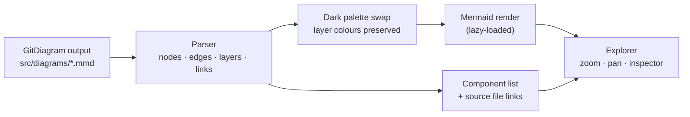

<div align="center">

<br />


# David Muumbi Mbuvi

### I build software that solves real problems.

**Computer Science student · Software & Systems Developer**
Fourth year, BSc Computer Science, Moi University

<sub>**David Mbuvi** and **Mbuvi Tech** · full name David Muumbi Mbuvi</sub>

<br />

[](https://react.dev)
[](https://www.typescriptlang.org)
[](https://vitejs.dev)
[](https://mermaid.js.org)
[](#-deploy)

[**GitHub**](https://github.com/cheekydavy) &nbsp;·&nbsp; [**Email**](mailto:mbuvidavid26@gmail.com) &nbsp;·&nbsp; [**Phone**](tel:+254746440595)

[**🌐 Live portfolio**](https://portfolio.kensync.co.ke)

<br />

</div>

---

## ✦ What this is

My personal engineering portfolio (**David Mbuvi** / **Mbuvi Tech**): five real software projects, each with an **interactive architecture diagram generated from its own repository**. The idea is that you can see not just *what* I built, but *how the pieces connect*.

The site is a dark, blueprint-styled React app with no UI framework, no backend and no secrets. It builds to plain static files.

---

## ✦ Projects

| | Project | Status | Built with | Repo |
| :-: | :-- | :-- | :-- | :-: |
| 🧾 | **Integrated POS & Business Communication Platform**<br/><sub>Sales, inventory, purchasing, customers, reporting, branches, role-based access and M-Pesa payments</sub> | 🟢 Complete | Next.js · Express · PostgreSQL · Prisma · Safaricom Daraja · WhatsApp Cloud API | — |
| 📚 | **SmartStudy**<br/><sub>Study sessions, AI-assisted notes, quizzes and progress tracking</sub> | 🟢 Complete | JavaScript · Node.js · Express · MongoDB · Groq API | [`smartstudy`](https://github.com/cheekydavy/smartstudy) |
| 📡 | **CampusMesh**<br/><sub>Exploring offline campus messaging between nearby devices</sub> | 🟢 Complete | Kotlin · Android · Room | [`campusmesh`](https://github.com/cheekydavy/campusmesh) |
| 💬 | **Mbuvi MD**<br/><sub>Modular WhatsApp automation with a command registry and plugins</sub> | 🟢 Complete | Node.js · PostgreSQL · WhatsApp | [`mbuvimd-db`](https://github.com/cheekydavy/mbuvimd-db) |
| ✈️ | **Flight Management & Booking System**<br/><sub>Flights, bookings, crew matching, JWT auth and reports</sub> | 🟢 Complete | React · Java · PostgreSQL | [`kenya-airways`](https://github.com/cheekydavy/kenya-airways) |

> [!NOTE]
> The POS is the flagship project. The flight project is an independent portfolio piece and is not affiliated with Kenya Airways.

---

## ✦ Highlights

<table>
<tr>
<td width="50%" valign="top">

### 🧭 Architecture explorer
Open any project and inspect its architecture: zoom, fit, pan, click a component to see what it connects to, and jump to the source file on GitHub.

</td>
<td width="50%" valign="top">

### ⚡ Fast by design
Mermaid is **loaded only when a diagram opens**, so the home page stays light. Everything else is hand-written CSS and a small React app.

</td>
</tr>
<tr>
<td width="50%" valign="top">

### 📱 Responsive and accessible
Mobile-first layouts, keyboard-friendly navigation and dialogs with focus trapping, reduced-motion support, and semantic HTML.

</td>
<td width="50%" valign="top">

### 🔍 Honest content
No invented metrics, clients, awards or skill percentages. Live GitHub data (language, last update) appears only when available.

</td>
</tr>
</table>

---

## ✦ How the architecture explorer works



- Each diagram is the **unmodified GitDiagram output** for its repository.
- The parser reads components, relationships and `click` links straight from the file, so updating a diagram means replacing one `.mmd` file.
- If Mermaid ever fails to render, the explorer falls back to a layered view, the source files and a direct GitHub link.

---

## ✦ Tech stack

| Layer | Choice | Why |
| :-- | :-- | :-- |
| UI | React 18 + TypeScript | Reusable components, typed content model |
| Build | Vite 5 | Instant dev server, small static output |
| Diagrams | Mermaid 11 | Renders the repository-derived diagrams |
| Styling | Hand-written CSS | One small design system, no framework overhead |
| Routing | Real URLs (`/projects/pos`) | Each project has its own indexable page |
| SEO | Build-time pre-rendering | Unique title, description, canonical, structured data and readable content per URL, plus `sitemap.xml` |

---

## ✦ Run it locally

Requires **Node 18.18+** (20 or 22 recommended).

```bash
npm install
npm run dev          # http://localhost:5173
```

| Script | What it does |
| :-- | :-- |
| `npm run dev` | Start the dev server |
| `npm run build` | Production build into `dist/` |
| `npm run preview` | Serve the production build locally |
| `npm run typecheck` | Type-check with `tsc --noEmit` |

---

## ✦ Deploy

It is a static site, so any static host works. Each URL is pre-rendered to its own HTML file by `scripts/prerender.mjs` (run automatically by `npm run build`), so no rewrite rules are needed. `base` is `'/'`, so it must be served from the root of a domain or subdomain. Set `SITE_URL` at build time if the address ever changes (default: `https://portfolio.kensync.co.ke`).

| Host | Settings |
| :-- | :-- |
| **Vercel** | Preset *Vite* · build `npm run build` · output `dist` |
| **Netlify** | Build `npm run build` · publish `dist` |
| **Cloudflare Pages** | Preset *Vite* · build `npm run build` · output `dist` |
| **GitHub Pages** | Enable *Settings → Pages → GitHub Actions*; the workflow in `.github/workflows/deploy.yml` does the rest |

<details>
<summary><b>SEO checklist after going live</b></summary>

<br/>

- Canonical URLs, Open Graph/Twitter tags, structured data, `sitemap.xml` and `robots.txt` are generated automatically.
- Add `public/og.png` (1200×630) and `public/apple-touch-icon.png` (180×180); the tags already point to them.
- Verify the site in Google Search Console and Bing Webmaster Tools, then submit `https://portfolio.kensync.co.ke/sitemap.xml`.
- Link to the site from your GitHub profile and other profiles using the same names (David Mbuvi, Mbuvi Tech).
- Commit `package-lock.json` for reproducible installs, and switch the Pages workflow from `npm install` to `npm ci`.

</details>

---

## ✦ Project structure

```text
src/
├── data/
│   ├── projects.ts          # the five projects: copy, status, layers, legend, links
│   ├── site.ts              # about, skills, attachment, education, certifications
│   └── tones.ts             # dark palette that replaces GitDiagram's light colours
├── diagrams/                # repository-derived Mermaid files (*.mmd)
├── lib/
│   ├── diagram.ts           # parses a .mmd into nodes, edges, groups and source links
│   ├── mermaidTheme.ts      # one place that themes every Mermaid render
│   └── github.ts            # optional live repo metadata, fails gracefully
├── hooks/                   # hash router, reduced-motion hook
├── components/              # Hero, Projects, ProjectDetail, ArchitectureExplorer, ...
└── styles/global.css        # the entire design system
```

<details>
<summary><b>Editing content</b></summary>

<br/>

| To change | Edit |
| :-- | :-- |
| Project copy, status, links | `src/data/projects.ts` |
| About text, skills, attachment | `src/data/site.ts` |
| Contact details | `person` in `src/data/site.ts` and the JSON-LD block in `index.html` |
| Names used for search (David Mbuvi, Mbuvi Tech) | `<title>`, meta tags and the `alternateName` list in `index.html`; the " as" line in `Hero.tsx` |
| An architecture diagram | Replace the matching file in `src/diagrams/` |

If a new diagram introduces a new colour class, add it to `src/data/tones.ts` and to that project's `legend`.

</details>

---

## ✦ Content integrity

This site only claims what the repositories and my background support.

- ✅ All five projects are labelled **Complete**, with no deployment, user or performance claims.
- ✅ Skills are grouped tags, never percentages. A cyan dot appears only where a technology shows up in a featured project's documented architecture.
- ✅ Diagrams show structure, not proof that every feature is deployed.
- ✅ No stars, user counts, client names, awards or testimonials are invented.
- ✅ No contact form, because none is implemented; contact is by email, phone and GitHub.

---

## ✦ About me

Fourth-year Computer Science student at **Moi University** with a **three-month industrial attachment at Infix Africa Limited**, covering website development and deployment, POS/ERP workflows, networking and technical support, and API and M-Pesa integration testing.

**Certifications:** Cisco Networking Essentials · Cisco Network Engineering Basics

**Skills:** Java · Python · JavaScript · Kotlin · C &nbsp;|&nbsp; React · Node.js · Express · Flask · REST APIs &nbsp;|&nbsp; PostgreSQL · MongoDB · Supabase · Room &nbsp;|&nbsp; Git · Docker · Linux · TCP/IP

---

<div align="center">

### Let's build something useful.

Have an interesting project, idea, or technical problem worth solving? I'd love to hear about it.

[](mailto:mbuvidavid26@gmail.com)
[](https://github.com/cheekydavy)
[](tel:+254746440595)

<sub>© David Muumbi Mbuvi</sub>

</div>
